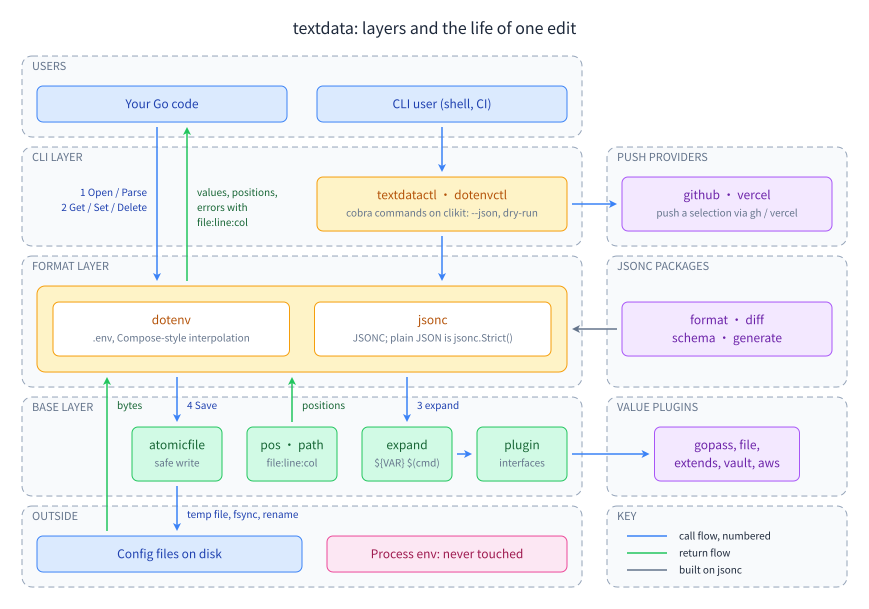

<h1 align="center">textdata</h1>
<p align="center"><strong>Edit config files in Go without losing a single comment.</strong></p>
<p align="center">Comment- and byte-preserving parsers and editors for <code>.env</code> (dotenv) and JSONC / JSON, with <code>${VAR}</code> expansion, secret plugins and a CLI. Standard library only.</p>

<p align="center">
  <a href="https://pkg.go.dev/github.com/ubgo/textdata"></a>
  <a href="https://github.com/ubgo/textdata/releases"></a>
  <a href="LICENSE"></a>
  
  
  <a href="https://github.com/ubgo/textdata/stargazers"></a>
</p>

textdata is an open-source Go library for comment- and byte-preserving parsing and editing of human-edited config files: `.env` (dotenv, with Docker Compose interpolation) and JSONC (JSON with comments, plus plain JSON). Every format keeps the file a person wrote: parse it, read it, change one value, save it, and every comment, blank line, key order, quoting choice and line ending you did not touch is written back exactly as it was. No third-party parser libraries: every format is parsed by code in this repository. On top of the parsers sit `${VAR}` expansion, value plugins for secrets (gopass, files, HashiCorp Vault, AWS Secrets Manager and SSM), JSON Schema, lint, format and diff for JSONC, and the `textdatactl` CLI that pushes environment variables to GitHub Actions and Vercel.

`github.com/ubgo/textdata` is a multi-module repository: a small shared base (this module), one module per format, value and provider plugins, and the CLIs. Formats today: [dotenv](dotenv/README.md) (moved here from `github.com/ubgo/dotenv`) and [JSONC / JSON](jsonc/README.md). YAML and TOML come only when a tool needs them.

Status: **released.** Every module was first released at `v0.1.4` (`v0.1.4`, `dotenv/v0.1.4`, …); `jsonc`, `jsonc/cli` and `textdatactl` are now at `v0.1.5`. The earlier `v0.1.1`–`v0.1.3` tags are retracted. `textdatactl` ships prebuilt binaries on the [releases page](https://github.com/ubgo/textdata/releases). `go get` the module path you need, for example `go get github.com/ubgo/textdata/dotenv@latest`.

**Contents:** [Why textdata?](#why-textdata) · [Install](#install) · [Quick start](#quick-start) · [Documentation](#documentation) · [Modules](#modules) · [Guarantees](#guarantees-every-format-keeps) · [Dependency rules](#dependency-rules) · [The base packages](#the-base-packages) · [CLIs](#clis) · [Releases](#releases) · [Development](#development) · [FAQ](#faq) · [Contributing](#contributing) · [License](#license)

## Why textdata?

Config files are written by people and read by programs, and most Go code that touches them decodes into a map or struct and writes the result back out. That throws away everything a person put there on purpose: the comment explaining why a timeout is 90 seconds, the commented-out staging URL, the key order, the quoting. textdata treats the file as the source of truth instead: it keeps a lossless model of the bytes, so a tool can change one key in a committed `.env` or `config.jsonc` and produce a one-line diff.

- **Byte-exact round trip.** `Parse(x).Render() == x` for every input, valid or not, pinned by fuzz and property tests rather than promised in prose.
- **Edits touch only their own bytes.** Set, insert after a sibling, comment out and restore, delete: comments, order, indentation, quoting and line endings elsewhere survive.
- **Standard library only.** The base and the format modules import nothing outside the Go standard library; importing `dotenv` pulls in the base and dotenv, nothing else.
- **One engine across formats.** `${VAR}`, `${VAR:-default}`, `${VAR:?error}`, `$(cmd)` (off unless you turn it on) and `${scheme:ref}` behave the same in dotenv and JSONC, and a value plugin written once works in both.
- **Secrets stay out of the file.** Opt-in plugin modules resolve `${gopass:…}`, `${file:…}`, `${vault:…}` and `${aws:…}` references at read time; an unreachable store is an error, never a silent empty value.
- **Errors you can act on.** Every parse and expansion error carries `file:line:col` and a plain message.
- **A CLI with a contract.** `textdatactl` gives get, set, diff, a drift matrix across environments, `run`, and push to GitHub Actions and Vercel, with a `--json` envelope and stable exit codes.

| | **textdata** | Decode, edit, re-encode (`encoding/json`, map round trips) | Read-only `.env` loaders | Hand-written regex or line edits |
|---|---|---|---|---|
| Keeps comments and blank lines on save | ✅ | ❌ | ❌ (no writer) | ⚠️ until the file gets unusual |
| Keeps key order, quoting and line endings | ✅ | ❌ | ❌ (no writer) | ⚠️ |
| Byte-exact round trip, fuzz-tested | ✅ | ❌ | ❌ | ❌ |
| JSON with comments and trailing commas | ✅ | ❌ | n/a | ⚠️ |
| `${VAR}` expansion with Compose operators | ✅ | ❌ | ⚠️ varies | ❌ |
| Secret references from Vault, AWS, gopass | ✅ opt-in modules | ❌ | ⚠️ varies | ❌ |
| `file:line:col` errors | ✅ | ⚠️ byte offset | ⚠️ varies | ❌ |
| Third-party dependencies | none (stdlib) | none | ⚠️ varies | none |

If you only need to load a `.env` into the process at startup, a small loader is enough. If a program writes config files that people also edit, review and commit, that is what textdata is for.

## Install

Each module is its own `go get`; take only the ones you use.

```sh
go get github.com/ubgo/textdata/dotenv@latest     # .env files
go get github.com/ubgo/textdata/jsonc@latest      # JSONC and plain JSON
go get github.com/ubgo/textdata/plugins/vault@latest   # optional: one module per value plugin
go install github.com/ubgo/textdata/cmd/textdatactl@latest   # the CLI
```

The libraries need Go 1.22 or newer (the `file` and `extends` plugins 1.24); the CLI modules need Go 1.26.4. Prebuilt `textdatactl` binaries for macOS, Linux and Windows are on the [releases page](https://github.com/ubgo/textdata/releases).

## Quick start

### dotenv

Read a value raw and expanded, change another, and render the file. The comment and the `${DOMAIN}` reference come back as written.

<!-- snippet: exempt — verified by hand against the code on 2026-11-13 -->
```go
f := dotenv.Parse("# where the API lives\nDOMAIN=staging.acme.io\nAPI_URL=https://api.${DOMAIN}\n")

url, _, err := f.GetExpanded("API_URL") // https://api.staging.acme.io <nil>
fmt.Println(url, err)

f.Set("DOMAIN", "acme.io")
fmt.Print(f.Render())
// # where the API lives
// DOMAIN=acme.io
// API_URL=https://api.${DOMAIN}
```

`dotenv.Open(path)` and `f.Save()` do the same against a file on disk, saving atomically. More in the [dotenv README](dotenv/README.md) and the [dotenv guides](docs/guides/dotenv).

### JSONC

Set a value, add a key next to a sibling and comment one out in a commented config. Only the touched bytes change.

<!-- snippet: exempt — copied from jsonc/example_test.go (Example) -->
```go
doc, err := jsonc.Parse([]byte(`{
  // Where to sync
  "sync": {
    "remote": "origin", // git remote name
    "interval": 30,
  },
}
`))
if err != nil {
	log.Fatal(err)
}
_ = doc.Set("sync.interval", 60)
_ = doc.SetAfter("remote", "sync.branch", "main")
_ = doc.Disable("sync.interval")
os.Stdout.Write(doc.Render())
// {
//   // Where to sync
//   "sync": {
//     "remote": "origin", // git remote name
//     "branch": "main",
//     // "interval": 60,
//   },
// }
```

Plain JSON is the same package with `jsonc.Strict()`. More in the [jsonc README](jsonc/README.md) and the [jsonc guides](docs/guides/jsonc).

### Command line

```sh
textdatactl dotenv get API_URL --expand
textdatactl dotenv set DEBUG=true --dry-run
textdatactl jsonc set config.jsonc sync.interval 60 --json-value
```

See [textdatactl](docs/guides/getting-started/textdatactl.md) for every verb.

## Documentation

- **[Learning path](docs/README.md#learning-path)**: 14 steps from a first read to the full production setup, each with a guide and a runnable program under [`examples/`](examples).
- **[Choosing](docs/choosing/README.md)**: which format and modules, which method, which secret backend, which options for your kind of app, library or CLI.
- **[Feature index](docs/reference/features.md)**: all 136 features, each with its package, the guide step that teaches it and an example that runs it.
- **[All guides](docs/README.md#all-pages)**: getting started, dotenv, jsonc, jsonc tools, value plugins, the command line, push providers, base packages.



## Modules

| Module | Path | What |
|---|---|---|
| [`github.com/ubgo/textdata`](#the-base-packages) | `.` | the shared base: `plugin`, `expand`, `atomicfile`, `pos`, `path`, `texttest`; stdlib only |
| [`…/dotenv`](dotenv/README.md) | `dotenv/` | the `.env` library: lossless parse, edit, Docker Compose interpolation, plugins |
| [`…/dotenv/cli`](dotenv/cli/README.md) | `dotenv/cli/` | the `dotenvctl` binary and its command package `dotenvcmd`, the operations API `envkit`, `.env` family discovery |
| [`…/jsonc`](jsonc/README.md) | `jsonc/` | JSONC: lossless parse, read, edit, Disable/Restore, save, expansion; plain JSON is `jsonc.Strict()` |
| [`…/jsonc/cli`](jsonc/cli/README.md) | `jsonc/cli/` | the jsonc command package, mounted as `textdatactl jsonc` |
| [`…/clikit`](clikit/README.md) | `clikit/` | shared CLI plumbing: the `{ok,data\|error}` output envelope and error codes, HTML reports, dry-run diff, selection grammar, provider-plugin seam |
| [`…/cmd/textdatactl`](cmd/textdatactl) | `cmd/textdatactl/` | the umbrella CLI: `textdatactl dotenv …`, `textdatactl jsonc …` |
| [`…/dotenv/cli/providers/github`](dotenv/cli/providers/github/README.md) | `dotenv/cli/providers/github/` | provider plugin: push a selection of values to GitHub Actions secrets through `gh` |
| [`…/dotenv/cli/providers/vercel`](dotenv/cli/providers/vercel/README.md) | `dotenv/cli/providers/vercel/` | provider plugin: push a selection of values to Vercel environment variables through `vercel` |
| [`…/plugins/gopass`](plugins/gopass/README.md) | `plugins/gopass/` | value plugin: `${gopass:path}` references from a gopass store |
| [`…/plugins/file`](plugins/file/README.md) | `plugins/file/` | value plugin: `${file:./key.pem}` references read from a file |
| [`…/plugins/extends`](plugins/extends/README.md) | `plugins/extends/` | value plugin: loads `$extends` base files from somewhere other than the local disk |
| [`…/plugins/vault`](plugins/vault/README.md) | `plugins/vault/` | value plugin: references resolved from HashiCorp Vault (KV v1 and v2) |
| [`…/plugins/aws`](plugins/aws/README.md) | `plugins/aws/` | value plugin: references resolved from AWS Secrets Manager and SSM Parameter Store |

Every module path starts with `github.com/ubgo/textdata`. Value plugins (`plugins/`) are written once against the base `plugin` package, require only the base, and work in every format; their cross-format tests live in the test-only `integration/` module, which is never tagged. Provider plugins (`dotenv/cli/providers/`) push a flat key/value selection to a hosting service; each is its own module needing only `clikit` and cobra, so another CLI can mount one without pulling dotenv. No module requires a sibling it only uses in tests.

## Guarantees every format keeps

- `Parse(x).Render() == x`, byte for byte, for every input, valid or not.
- An edit changes only the bytes it touches. Comments, blank lines, key order, indentation, quoting and line endings elsewhere survive.
- Never touches the process environment. Never runs a command unless the caller turns that on.
- Errors carry `file:line:col` and a plain message (`config.jsonc:2:3: object keys must be double-quoted (unquoted keys are JSON5)`).
- The base and the format modules use the Go standard library only.

Each guarantee is pinned by fuzz and property tests (through `texttest`), never by prose.

## Dependency rules

- Formats and value plugins import the base; the base never imports a format.
- Formats never import each other or a plugin. A cross-format plugin is written once against `plugin` and works in every format.
- `clikit` imports no format. A format's CLI module imports its format, `clikit` and the provider plugins it mounts; provider plugins import only `clikit` and never parse a file.
- Format-specific rules stay in the format: dotenv's quoting (single quotes are never expanded) and its top-to-bottom self-reference rule live in dotenv, jsonc's comment attachment in jsonc.
- **The base is public API with a backward-compatibility promise.** Go's minimal version selection can pair `jsonc vX` with a newer base pulled in by another format, so base changes are additive only.

## The base packages

```sh
go get github.com/ubgo/textdata
```

The root package holds no code; the base lives in its sub-packages, each stdlib only.

### plugin

The plugin interfaces every format accepts. A plugin has a `Name()` and implements only the abilities it needs; a format detects them once, at install, by type assertion, and reports what it found (`Info{Name, Capabilities}`, rendered as `vault: Lookuper, Resolver`), so a method with a slightly wrong signature shows up as a missing capability instead of silently never running.

| Interface | Method | Does |
|---|---|---|
| `Plugin` | `Name() string` | required, so an error names the plugin |
| `Lookuper` | `Lookup(name) (value, ok, err)` | a value for `${NAME}` the file does not define; first answer wins; an error aborts |
| `Resolver` | `Schemes() []string`, `Resolve(scheme, ref) (string, error)` | `${scheme:ref}` references (`${gopass:personal/db}`); a scheme nobody owns reads as before |
| `CommandRunner` | `RunCommand(cmd) (string, error)` | runs `$(cmd)`; a replacement, last installed wins; installing one turns substitution on |
| `ValueTransformer` | `TransformValue(path, value) (string, error)` | changes a value on read, after expansion; chained; `path` is the key (dotenv) or canonical path (jsonc) |
| `ExpandObserver` | `ObserveExpand(path, name, resolved)` | sees every reference resolution (dead-key detection) |
| `SaveGuard` | `GuardSave(doc Document) error` | may veto a save, never rewrite it |
| `Validator` | `Validate(doc Document) error` | checks a document; runs only when asked |
| `Includer` | `Include(from, ref) ([]byte, string, error)` | loads `$extends` targets from somewhere other than disk |

`Document` is the read-only view a guard or validator receives (`FormatName`, `Location`, `ValuePaths`, `ValueAt`, `Bytes`); every format's document type implements it. Also here: `Registry` (install order, capability filters, `NameFor` so an error names the plugin that failed), `*Error` (`dotenv: plugin "vault": lookup DB_PASSWORD: connection refused`), and the named errors `ErrUnavailable`, `ErrUnsupportedScheme`, `ErrDenied`, `ErrNotFound`. A plugin that is down is an error, never a silent "missing": an unreachable secret store must not look like an unset variable.

### expand

One expansion engine, string in, string out: `$VAR`, `${VAR}`, the six operators (`${VAR-d}`, `${VAR:-d}`, `${VAR+a}`, `${VAR:+a}`, `${VAR?e}`, `${VAR:?e}`), nesting (`${A:-${B:-c}}`), `$$` as a literal dollar, `$(cmd)` and `${scheme:ref}`. It knows no file format: an `Engine{Lookup, Resolve, Run, Observe, Required, MaxDepth}` takes callbacks, and the format keeps its own rules (which quoting suppresses expansion, which definition a self-reference sees, which error type `${VAR:?e}` produces). `Run == nil` keeps `$(cmd)` verbatim; a failing command is a `*expand.CommandError`. A `Stack` of the names being expanded cuts cycles; depth 32 is a backstop. Hand-written because `os.Expand` cannot express `$$` or nesting.

<!-- snippet: exempt — no Example test in package expand yet; verified by hand against the code on 2026-11-12 -->
```go
vars := map[string]string{"HOST": "db.internal"}
eng := expand.Engine{
	Lookup: func(name string, _ *expand.Stack) (expand.Var, error) {
		v, ok := vars[name]
		return expand.Var{Value: v, Set: ok, At: expand.AtLookup}, nil
	},
}
out, err := eng.Expand("postgres://${HOST}:${PORT:-5432}/app costs 5$$", expand.NewStack())
fmt.Println(out, err) // postgres://db.internal:5432/app costs 5$ <nil>
```

### atomicfile

`Write(path, data, Options{Mode, KeepMode, TempSuffix, NoFollow, Chmod, Rename})` saves a file safely: it resolves symlinks first so the real file is replaced and the link survives (`NoFollow` replaces the link itself), writes a sibling temp file at 0600, fsyncs it, chmods it to the target mode explicitly (umask filters `os.WriteFile`'s mode), renames it over the target and fsyncs the folder best-effort. `KeepMode` keeps an existing target's permissions. A crash leaves the old file intact; a failed write removes the temp file.

### pos

`Pos{Offset, Line, Col}` (1-based line, byte column), an `Index` built once per source to map offsets to positions (CRLF files report the same lines as LF), `Error{File, Pos, Msg, Err}` rendering `file:line:col: msg`, and `ErrorList` (every problem in one source; `Sort` orders by file then offset, `Err()` returns nil when empty).

### path

Paths for tree formats: `Parse("a.\"b.c\"[2]")` (dotted, with quotes for names holding `.`, `[`, `]`, `"` or `\`), `ParsePointer("/a/b~1c/2")` (RFC 6901), and `ParseAny`, which reads a leading `/` as a JSON Pointer. A `Path` is a list of key and index segments; `String()` renders the canonical dotted form and `Pointer()` the RFC 6901 form. dotenv keys are flat and do not use it.

### texttest

The test harness that pins the guarantees: `RoundTrip(t, input, render)` (byte-exact round trip), `Untouched` / `CheckUntouched` (bytes outside an edited window are unchanged), `DiffWindow(a, b)`, `Seed(f, extra...)` to share fuzz seeds, and `Corpus`, a format-agnostic set of awkward inputs (empty, BOM, CRLF, lone CR, NUL, invalid UTF-8, very long lines).

## CLIs

`dotenvctl` is dotenv's standalone binary; `textdatactl` is the umbrella binary with one namespace per format. Mounting is by delegation: `textdatactl dotenv <args>` hands `<args>` to the format's command package, so flags, exit codes (`0` ok, `1` failed, `2` usage), the `--json` envelope and exec plugins behave exactly as in the standalone binary.

```sh
go install github.com/ubgo/textdata/cmd/textdatactl@latest
textdatactl dotenv get API_URL --expand
textdatactl dotenv set DEBUG=true --dry-run
```

## Releases

Each module is tagged on its own, with a path-prefixed tag for every module below the root: `v0.1.4` (base), `dotenv/v0.1.4`, `jsonc/v0.1.4`, `clikit/v0.1.4`, `plugins/vault/v0.1.4`, `dotenv/cli/providers/github/v0.1.4`, `dotenv/cli/v0.1.4`, `cmd/textdatactl/v0.1.4`, and so on. `v0.1.4` is the first public release of every module; the pre-release `v0.1.1`–`v0.1.3` tags are retracted in each `go.mod`, so `go get …@latest` never picks them. Modules are tagged in dependency order, base first, then the formats and `clikit`, then the value plugins and providers, then the format CLIs, then `cmd/textdatactl`. Version bumps are PATCH only, and releases are manual: no CI runs on push. Each module's `CHANGELOG.md` lists its releases.

## Development

```sh
task test       # quick: every module
task check      # the full gate
task fuzz:list  # every fuzz target
task fuzz -- ./jsonc FuzzParseRender 30s
task fuzz:all FUZZTIME=30s
```

## FAQ

**Does textdata keep comments when it saves a `.env` or JSONC file?** Yes. Comments, blank lines, key order, indentation, quoting and line endings you did not edit are written back byte for byte; only the bytes of the value you changed differ.

**Is `Parse(x).Render() == x` really true for broken files?** Yes, for every input, valid or not. A file with a syntax error still renders unchanged and saves unchanged; edits on it are refused with a `file:line:col` error. Fuzz tests pin this for both formats.

**Does importing `textdata/dotenv` pull in third-party dependencies?** No. The base and the format modules use the Go standard library only, and a module that imports `dotenv` lists only the base and `dotenv` in `go list -m all`. Plugins and CLIs are separate modules you add only when you use them.

**Does it set environment variables or run shell commands?** Never on its own. Parsing and expansion never touch the process environment, and `$(cmd)` substitution stays verbatim unless the caller installs a command runner.

**Can it read secrets from Vault, AWS or gopass instead of the file?** Yes, through value plugins: `plugins/vault` (KV v1 and v2), `plugins/aws` (Secrets Manager and SSM Parameter Store), `plugins/gopass` and `plugins/file`. The file keeps a `${scheme:ref}` reference and the value is resolved at read time; a store that is down is an error.

**Does `jsonc` handle plain JSON too?** Yes. `jsonc.Strict()` accepts exactly what `encoding/json.Valid` accepts and turns comments and trailing commas into errors. JSON5 features (unquoted keys, single quotes) are rejected with a message that says so.

**Is YAML or TOML supported?** Not yet. They come only when a tool needs them, and they will follow the same round-trip guarantees.

**How is this different from `godotenv` or `encoding/json`?** Those read a file into values; writing back regenerates the text, so comments and layout are lost. textdata edits the file in place, which is what you want when a program updates config that people also maintain by hand.

## Contributing

Issues and pull requests are welcome; read [CONTRIBUTING.md](CONTRIBUTING.md) first. Report security problems privately as described in [SECURITY.md](SECURITY.md). Everyone taking part follows the [Code of Conduct](CODE_OF_CONDUCT.md).

## License

[Apache License 2.0](LICENSE). Copyright 2026 Aman Bansal. Every module carries its own copy of the license.
