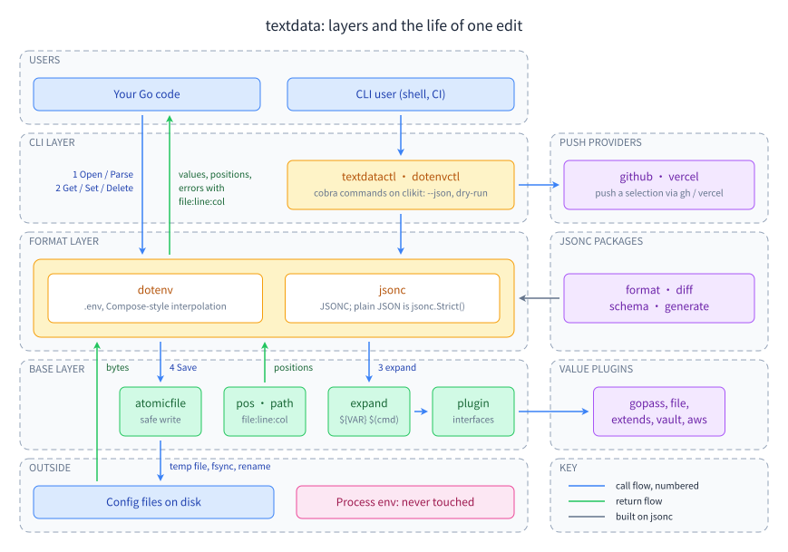

# textdata documentation

Guides, decision pages and runnable examples for every textdata module: the `dotenv` and `jsonc` libraries, the value plugins, the `textdatactl` and `dotenvctl` command lines, and the push providers. Every snippet in the guides is copied from a program under [`examples/`](../examples) that the test suite builds and runs, and every "Try it" output is real.

## Learning path

Follow the steps in order the first time; each one builds on the previous. Every step names what you learn, the guide, and the program to run (`cd examples/<area>/<name> && go run .`).

| # | Step | What you learn | Guide | Example |
|---|---|---|---|---|
| 1 | First read | `go get`, read a `.env` and a JSONC file into a map, open them as documents, read by path, decode into a struct | [Install and read your first file](guides/getting-started/install-and-first-read.md) | [`getting-started/first-read`](../examples/getting-started/first-read) |
| 2 | Edit and save | change one value, save atomically, and see that every other byte is unchanged | [Edit and save](guides/getting-started/edit-and-save.md) | [`getting-started/edit-save`](../examples/getting-started/edit-save) |
| 3 | dotenv syntax and reading | quoting, multi-line values, comments, duplicates, escapes; `Read` vs `Open` vs `Parse`; entries and kinds | [dotenv syntax](guides/dotenv/syntax.md), [reading](guides/dotenv/reading.md), [entries](guides/dotenv/entries.md) | [`dotenv/syntax`](../examples/dotenv/syntax), [`dotenv/reading`](../examples/dotenv/reading) |
| 4 | Expansion | `${VAR}`, the Compose operators, `${NAME:?}` for required values, `$(cmd)` off by default, typed config | [dotenv expansion](guides/dotenv/expansion.md), [typed config](guides/dotenv/typed-config.md) | [`dotenv/expansion`](../examples/dotenv/expansion), [`dotenv/typed-config`](../examples/dotenv/typed-config) |
| 5 | Edit a `.env` file properly | `Set` vs `SetAfter`, comment out and restore, generate, clone to another environment, save modes | [dotenv editing](guides/dotenv/editing.md), [saving](guides/dotenv/saving.md) | [`dotenv/editing`](../examples/dotenv/editing), [`dotenv/clone-env`](../examples/dotenv/clone-env) |
| 6 | JSONC read and edit | strict JSON, typed getters, paths and JSON Pointer, positions, `Set`, arrays, comments, `Disable`/`Restore`, `Save` | [parse and strict](guides/jsonc/parse-and-strict.md), [read and paths](guides/jsonc/read-and-paths.md), [edit](guides/jsonc/edit.md), [save](guides/jsonc/save.md) | [`jsonc/read-config`](../examples/jsonc/read-config), [`jsonc/edit-config`](../examples/jsonc/edit-config) |
| 7 | Layered config | a base file plus overrides with `Merge`, or `"$extends"` with an includer | [merge and clone](guides/jsonc/merge-clone.md), [extends](guides/jsonc/extends.md) | [`jsonc/merge-layers`](../examples/jsonc/merge-layers), [`jsonc/extends`](../examples/jsonc/extends) |
| 8 | Lint, schema, format | lint rules, Validator plugins, JSON Schema from a struct with `file:line:col` issues, formatting and diffing | [lint and validate](guides/jsonc/lint-validate.md), [schema](guides/jsonc-tools/schema.md), [format](guides/jsonc-tools/format.md), [diff](guides/jsonc-tools/diff.md) | [`jsonc/lint`](../examples/jsonc/lint), [`jsonc-tools/schema-plugin`](../examples/jsonc-tools/schema-plugin) |
| 9 | Secrets with value plugins | Lookuper vs Resolver, one plugin in both formats, gopass, file, Vault, AWS | [plugins overview](guides/plugins/overview.md), then your backend | [`plugins/file-confined`](../examples/plugins/file-confined), [`plugins/vault-httptest`](../examples/plugins/vault-httptest) |
| 10 | The command line | `textdatactl`, every dotenv and jsonc verb, `--json`, exit codes, `run` | [textdatactl](guides/getting-started/textdatactl.md), [dotenvctl](guides/cli/dotenvctl.md), [jsonc CLI](guides/cli/jsonc-cli.md) | [`cli/verb-tour`](../examples/cli/verb-tour), [`cli/run-child`](../examples/cli/run-child) |
| 11 | Many environments | `envs`, the drift `matrix` with a contract as a CI gate, `diff`, HTML reports | [multi-env](guides/cli/multi-env.md), [recipes](guides/cli/recipes.md) | [`cli/verb-tour`](../examples/cli/verb-tour) |
| 12 | Push to GitHub and Vercel | select keys by prefix, guards for placeholders, dry runs, prune | [selection](guides/providers/selection.md), [GitHub](guides/providers/github.md), [Vercel](guides/providers/vercel.md) | [`providers/github`](../examples/providers/github), [`providers/selection`](../examples/providers/selection) |
| 13 | Embed and extend the tools | run the CLIs in process, the `envkit` operations API, exec plugins, your own push provider | [embedding](guides/cli/embedding.md), [envkit](guides/cli/envkit.md), [exec plugins](guides/cli/exec-plugins.md), [write a provider](guides/providers/write-a-provider.md) | [`cli/embed-dotenvctl`](../examples/cli/embed-dotenvctl), [`cli/envkit-ops`](../examples/cli/envkit-ops), [`providers/fake-provider`](../examples/providers/fake-provider) |
| 14 | Write a plugin, test a format | the plugin abilities, your own Resolver and SaveGuard, the expand engine, the property harness | [write a value plugin](guides/plugins/write-a-value-plugin.md), [base plugin](guides/base/plugin.md), [texttest](guides/base/texttest.md) | [`plugins/custom-resolver`](../examples/plugins/custom-resolver), [`base/property-harness`](../examples/base/property-harness) |

## Start from your goal

| You want to | Read | Run |
|---|---|---|
| Load config at startup into a struct | [dotenv typed config](guides/dotenv/typed-config.md), [jsonc decode](guides/jsonc/read-and-paths.md#step-7--decode-into-a-struct) | [`dotenv/typed-config`](../examples/dotenv/typed-config), [`jsonc/read-config`](../examples/jsonc/read-config) |
| Change one value in a file people commit, without reformatting it | [Edit and save](guides/getting-started/edit-and-save.md), [jsonc edit](guides/jsonc/edit.md) | [`getting-started/edit-save`](../examples/getting-started/edit-save) |
| Keep secrets out of the file | [Which value plugin](choosing/value-plugins.md), [plugins overview](guides/plugins/overview.md) | [`plugins/vault-httptest`](../examples/plugins/vault-httptest) |
| Fail fast when a required value is missing | [dotenv RequiredError](guides/dotenv/expansion.md#step-6--fail-loudly-with-requirederror), [jsonc](guides/jsonc/expansion-and-plugins.md#step-2--fail-loudly-on-a-missing-value) | [`dotenv/expansion`](../examples/dotenv/expansion) |
| Check in CI that every environment defines every key | [multi-env › contract](guides/cli/multi-env.md#step-3--gate-ci-on-a-contract) | [`cli/verb-tour`](../examples/cli/verb-tour) |
| Check a hand-written JSONC config against a schema | [schema](guides/jsonc-tools/schema.md) | [`jsonc-tools/schema-plugin`](../examples/jsonc-tools/schema-plugin) |
| Format or diff JSONC files | [format](guides/jsonc-tools/format.md), [diff](guides/jsonc-tools/diff.md) | [`jsonc-tools/format`](../examples/jsonc-tools/format), [`jsonc-tools/diff`](../examples/jsonc-tools/diff) |
| Generate a commented config file from a struct | [generate](guides/jsonc-tools/generate.md) | [`jsonc-tools/generate-from-struct`](../examples/jsonc-tools/generate-from-struct) |
| Push deploy secrets to GitHub Actions or Vercel | [GitHub](guides/providers/github.md), [Vercel](guides/providers/vercel.md) | [`providers/github`](../examples/providers/github) |
| Run a command with a file's values | [dotenvctl run](guides/cli/dotenvctl.md#step-4--run-a-command-with-the-files-values), [envkit child env](guides/cli/envkit.md#step-6--build-a-child-process-environment) | [`cli/run-child`](../examples/cli/run-child) |
| Give your own CLI the dotenv or jsonc verbs | [embedding](guides/cli/embedding.md) | [`cli/embed-jsonc`](../examples/cli/embed-jsonc) |
| Refuse to save a private key or an invalid file | [base plugin › SaveGuard](guides/base/plugin.md#step-1--write-a-plugin-with-the-abilities-it-needs), [jsonc save › SaveGuard](guides/jsonc/save.md#step-5--veto-a-save-with-a-saveguard) | [`base/registry`](../examples/base/registry) |
| Support a new secret store | [write a value plugin](guides/plugins/write-a-value-plugin.md) | [`plugins/custom-resolver`](../examples/plugins/custom-resolver) |
| Decide between options | [Choosing](choosing/README.md) | - |
| Find any feature | [Feature index](reference/features.md) | - |

## How it fits together

Your code or a shell calls a format (`dotenv`, `jsonc`), directly or through the CLI layer; the formats are built on the stdlib-only base packages and never touch the process environment. Value plugins plug into the base's `plugin` interfaces; push providers plug into the CLI.

## All pages

### Choosing

- [Overview](choosing/README.md)
- [Which format and which modules](choosing/format-and-modules.md)
- [Which method for the main workflows](choosing/methods.md)
- [Which value plugin or secret backend](choosing/value-plugins.md)
- [Options for your kind of app](choosing/app-setups.md)
- [Library, CLI or embedding the CLI](choosing/library-cli-or-embed.md)

### Getting started ([index](guides/getting-started/README.md))

- [Install and read your first file](guides/getting-started/install-and-first-read.md)
- [Edit and save a config file](guides/getting-started/edit-and-save.md)
- [textdatactl: the command line](guides/getting-started/textdatactl.md)

### dotenv ([index](guides/dotenv/README.md))

- [Reading](guides/dotenv/reading.md)
- [Syntax](guides/dotenv/syntax.md)
- [Entries and kinds](guides/dotenv/entries.md)
- [Expansion](guides/dotenv/expansion.md)
- [Editing](guides/dotenv/editing.md)
- [Saving](guides/dotenv/saving.md)
- [Plugins](guides/dotenv/plugins.md)
- [Typed configuration](guides/dotenv/typed-config.md)

### jsonc ([index](guides/jsonc/README.md))

- [Parse JSONC and strict JSON](guides/jsonc/parse-and-strict.md)
- [Read values and paths](guides/jsonc/read-and-paths.md)
- [Edit a document](guides/jsonc/edit.md)
- [Disable and restore a member](guides/jsonc/disable-restore.md)
- [Merge and clone](guides/jsonc/merge-clone.md)
- [Layer files with $extends](guides/jsonc/extends.md)
- [Expansion and plugins](guides/jsonc/expansion-and-plugins.md)
- [Lint and validate](guides/jsonc/lint-validate.md)
- [Save a document safely](guides/jsonc/save.md)

### jsonc tools ([index](guides/jsonc-tools/README.md))

- [Format](guides/jsonc-tools/format.md)
- [Diff](guides/jsonc-tools/diff.md)
- [Generate](guides/jsonc-tools/generate.md)
- [JSON Schema](guides/jsonc-tools/schema.md)

### Value plugins ([index](guides/plugins/README.md))

- [Overview](guides/plugins/overview.md)
- [gopass](guides/plugins/gopass.md)
- [file](guides/plugins/file.md)
- [extends](guides/plugins/extends.md)
- [vault](guides/plugins/vault.md)
- [aws](guides/plugins/aws.md)
- [Write a value plugin](guides/plugins/write-a-value-plugin.md)

### Command line ([index](guides/cli/README.md))

- [dotenvctl command reference](guides/cli/dotenvctl.md)
- [jsonc CLI](guides/cli/jsonc-cli.md)
- [Multi-environment tools](guides/cli/multi-env.md)
- [Recipes](guides/cli/recipes.md)
- [Exec plugins](guides/cli/exec-plugins.md)
- [Embed the CLIs](guides/cli/embedding.md)
- [envkit: the operations API in Go](guides/cli/envkit.md)

### Push providers and clikit ([index](guides/providers/README.md))

- [GitHub](guides/providers/github.md)
- [Vercel](guides/providers/vercel.md)
- [Key selection](guides/providers/selection.md)
- [Write a push provider](guides/providers/write-a-provider.md)
- [Output, error codes and reports](guides/providers/output-and-reports.md)

### Base packages ([index](guides/base/README.md))

- [Plugins: one interface set for every format](guides/base/plugin.md)
- [The expand engine](guides/base/expand.md)
- [Atomic writes](guides/base/atomicfile.md)
- [Paths and positions](guides/base/pos-and-path.md)
- [Testing a format with texttest](guides/base/texttest.md)

### Reference

- [Feature index](reference/features.md): every feature, its package, the guide step and the example
- Module READMEs: [base](../README.md), [dotenv](../dotenv/README.md), [dotenv/cli](../dotenv/cli/README.md), [jsonc](../jsonc/README.md), [jsonc/cli](../jsonc/cli/README.md), [clikit](../clikit/README.md), [textdatactl](../cmd/textdatactl/README.md), [GitHub provider](../dotenv/cli/providers/github/README.md), [Vercel provider](../dotenv/cli/providers/vercel/README.md), plugins [gopass](../plugins/gopass/README.md), [file](../plugins/file/README.md), [extends](../plugins/extends/README.md), [vault](../plugins/vault/README.md), [aws](../plugins/aws/README.md)
- API reference: [pkg.go.dev/github.com/ubgo/textdata](https://pkg.go.dev/github.com/ubgo/textdata)
